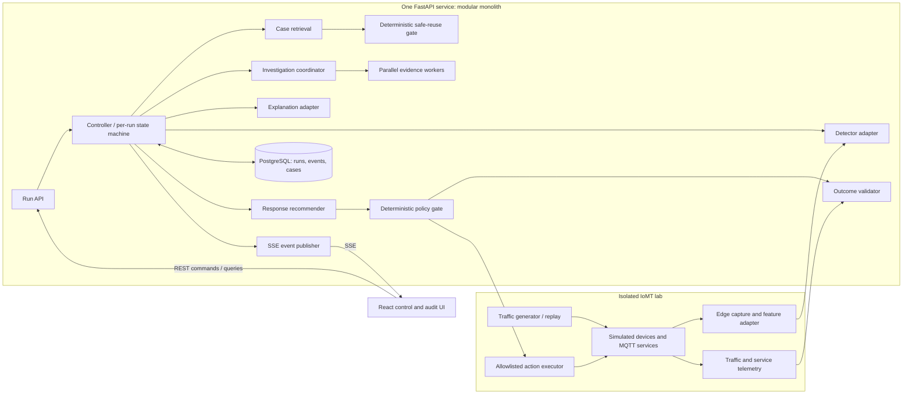

# IoMT Agent Orchestration Architecture

**Status:** Proposed implementation architecture  
**Date:** 10 October 2026  
**Scope:** Final Year Project proof of concept and controlled evaluation  
**Decision owners:** Project team; architecture and orchestration lead

## 1. Executive decision

Keep the proposal's research architecture: a Controller routes incidents through short, selective, or deep investigation; memory supplies prior cases; specialists produce bounded evidence; response reasoning recommends a constrained action; a deterministic policy gate approves, downgrades, or rejects it; an independent monitor measures the result; only validated outcomes update case reliability.

Change the implementation architecture in five ways:

1. **Use a modular monolith for the FYP.** The Controller, Memory, Investigator, specialists, Policy, and Response modules run in one FastAPI backend. They are logical agents with typed inputs and outputs, not separate network services or OS processes.
2. **Make the Controller the sole workflow owner.** It owns per-incident state transitions, deadlines, retries, cancellation, and the decision to invoke work. No specialist or LLM can change workflow state or invoke another agent.
3. **Use explicit typed messages and an append-only event journal.** Agents return evidence; the Controller persists events and publishes them to the UI. Use REST for commands and Server-Sent Events (SSE) for one-way progress updates.
4. **Keep risk routing, reuse authorization, policy, and outcome labels deterministic.** LLMs may help interpret evidence or draft explanations, but they do not route, authorize, execute, or declare success.
5. **Disable the fast path until detector confidence and outcomes are validated.** The current prototype's model is a TCP-flood replay with an uncalibrated probability signal, and the built-in gateway is a stub. Those inputs are not enough to justify autonomous investigation skipping or successful-reuse learning.

This keeps the research question intact while making the implementation testable before the detector team delivers the final model.

## 2. Requirements and boundaries

### Functional requirements

- Accept a detector event containing an attack label, confidence information, traffic evidence, target identity, and evidence provenance.
- Route each incident deterministically to a full, selective, or verified-reuse path.
- Retrieve prior cases and expose the fields and reasons used by the reuse gate.
- Run only the selected evidence workers; run independent workers concurrently with individual timeouts.
- Produce a structured investigation, explanation, and response recommendation.
- Enforce safety policy before an action can reach an executor.
- Observe attack traffic and legitimate service separately during a controlled response run.
- Persist enough events and experiment metadata to reconstruct a run and compare baselines.

### Non-functional requirements

- Fail closed when target criticality, detector confidence, policy inputs, action state, or outcome telemetry is unavailable.
- Make every transition and action idempotent or explicitly non-retryable.
- Keep the critical path independent of external LLM availability.
- Keep all generated attacks and actions inside an isolated, allowlisted lab.
- Preserve the same event contract for the local demo and live backend.
- Be small enough for a three-person FYP team to implement and operate.

### Out of scope for this architecture

Production hospital deployment, autonomous action on clinical devices, multiple hospitals or tenants, a general SOAR platform, unrestricted command execution, and a large distributed-agent cluster.

## 3. Recommended component topology



The boxes are modules and ports, not deployment units. For the current scale, network calls between agents would add failure modes without helping the research. A future deployment can split workers behind the same contracts if measured load or fault-isolation needs justify it.

## 4. Roles and authority

| Component | Owns | May do | Must not do |
|---|---|---|---|
| Edge adapter | Capture/flow integration and device mapping | Convert source records to versioned feature windows | Choose investigation path or response |
| Detector adapter | Model interface | Return prediction, calibrated confidence if available, feature evidence, model/schema version | Route incident or authorize action |
| Controller | Workflow state and scheduling | Validate events, choose path, invoke modules, persist transitions, enforce deadlines, request cancellation | Parse packets, invent evidence, execute a network command |
| Memory retriever | Candidate cases | Return ranked cases and matched fields | Decide that a case is safe to reuse |
| Safe-reuse gate | Reuse authorization | Return `VERIFY_ADAPT`, `INVESTIGATE_DELTA`, or `NO_REUSE` with reasons | Recommend or execute the final response |
| Evidence workers | One evidence domain each | Analyze immutable input and return a typed finding with provenance | Call other workers, mutate cases, change incident state, or take actions |
| Investigator | Evidence synthesis | Combine worker findings and expose uncertainty/conflicts | Treat unavailable evidence as a negative finding |
| Explanation | Operator-readable rationale | Summarize evidence, uncertainty, and the selected policy result | Change a decision or delay containment |
| Response recommender | Candidate action | Return one action from a fixed enum plus parameters and rationale | Emit shell commands or execute an action |
| Policy gate | Safety decision | `PASS`, `DOWNGRADE`, or `ESCALATE`; return rule-by-rule results | Call an LLM or infer missing facts optimistically |
| Executor | Action application | Apply one allowlisted, reversible lab action with an idempotency key | Accept free-form commands or bypass policy |
| Outcome validator | Outcome label | Compute `SUCCESS`, `PARTIAL`, `FAILURE`, `HARMFUL`, or `UNVALIDATED` from required telemetry | Infer success from an action being accepted or a service-only probe |

### Logical agents versus processes

Implement specialists as async Python callables behind interfaces. A worker receives an immutable `InvestigationRequest` and returns one `SpecialistFinding`. Use structured concurrency (`asyncio.TaskGroup` or equivalent) for parallel fan-out and per-worker timeouts. Do not start with one process, container, queue, or LLM conversation per agent. This is simpler to debug, keeps evidence contracts visible, and still allows concurrent work.

The Controller is an orchestrator, not another autonomous planner. Its routing and transitions are ordinary deterministic code. The Investigator is a reducer over specialist outputs, not a manager that delegates more work.

## 5. Incident lifecycle and synchronization

```mermaid
sequenceDiagram
  participant UI
  participant C as Controller
  participant D as Detector adapter
  participant M as Memory + reuse gate
  participant S as Evidence workers
  participant I as Investigator
  participant R as Response recommender
  participant P as Policy gate
  participant X as Lab executor
  participant O as Outcome validator
  participant DB as Event journal

  UI->>C: POST create run (idempotency key, frozen profile)
  C->>DB: Persist RUN_CREATED and configuration snapshot
  C-->>UI: run_id
  UI->>C: GET run event stream (SSE)
  C->>D: Request/receive versioned detector event
  D-->>C: DetectorEvent
  C->>DB: Persist DETECTED before scheduling downstream work
  par Candidate retrieval
    C->>M: Retrieve top-k compatible candidates
    M-->>C: CandidateCases + field-level scores
  and Mandatory context
    C->>S: Resolve target/device context
    S-->>C: DeviceContextFinding
  end
  C->>C: Deterministic risk route + safe-reuse gate
  alt Verified-reuse path
    C->>I: Verify current facts and adapt prior evidence
  else Selective or full investigation
    C->>S: Fan out selected independent workers
    S-->>C: Typed findings, unavailable statuses, provenance
    C->>I: Fuse findings after worker barrier/deadline
  end
  C->>R: Recommend bounded action from structured evidence
  R-->>C: ActionRecommendation
  C->>P: Evaluate exact action and current safety context
  P-->>C: PolicyDecision
  alt PASS or safe DOWNGRADE in lab
    C->>X: Apply action (idempotency key, expiry, target allowlist)
    X-->>C: Applied/rejected result
    C->>O: Validate attack suppression AND legitimate service
    O-->>C: OutcomeReport + evidence window
  else ESCALATE / failed policy
    C->>O: Record no-action or safe-hold outcome
  end
  C->>DB: Persist final outcome; update case trust only if eligible
  C-->>UI: Stream persisted lifecycle events
```

### Route rules

The literature and proposal use low/medium/high language; use explicit path names in code:

| Path | Preconditions | Work |
|---|---|---|
| `VERIFY_REUSE` | Detector confidence is trusted; top case passes subtype, device-context, prior-outcome, reliability, and evidence-completeness checks; no unresolved conflict | Verify mandatory current context, adapt the prior case, policy-check normally. Skip only the investigation that the gate explicitly marks reusable. |
| `INVESTIGATE_DELTA` | A relevant case exists, but some fields or context differ or remain unknown | Recompute changed and decision-relevant evidence; invoke only workers needed for those fields. |
| `INVESTIGATE_FULL` | No safe candidate, novel subtype, low/untrusted confidence, critical/unknown device context, conflicting findings, or incomplete evidence | Run the required evidence workers in parallel; synthesize after the deadline/barrier. |

**Initial safe default:** while confidence calibration and real outcome telemetry are unavailable, `VERIFY_REUSE` is disabled. The system may retrieve and display candidate cases, but must route to delta/full investigation and must not increase a case's reliability based on a stubbed recovery.

Risk routing and reuse authorization are separate. A high-similarity case does not lower a high-risk route. A critical device or unknown device class forces full investigation and human approval for any action that could disrupt it.

### Specialist selection and barriers

- **Always before action:** detector evidence, device/target context, policy inputs, and outcome-sensor readiness.
- **May run together:** traffic analysis, log analysis, device context, and history lookup when their source data is available and their inputs do not depend on each other.
- **Threat intelligence:** optional and advisory; do not put it on the containment critical path unless a policy rule explicitly depends on it.
- **Partial reuse:** select workers based on changed or unknown fields, not a fixed set per path name.
- **Join rule:** wait for required decision evidence or the per-run deadline. Optional timeout becomes an explicit `UNAVAILABLE` finding. Missing mandatory evidence routes to safe hold/escalation; it is never silently ignored.
- **No worker-to-worker calls:** the Controller schedules workers, correlates responses by request ID, and the Investigator merges the results.

## 6. Message contracts

All messages should be Pydantic models with a versioned JSON representation. Generate or validate the TypeScript types from the backend OpenAPI schema so the frontend does not maintain a second hand-written event definition.

### Event envelope

```json
{
  "schema_version": 1,
  "event_id": "evt_01...",
  "run_id": "run_01...",
  "incident_id": "inc_01...",
  "correlation_id": "req_01...",
  "sequence": 14,
  "occurred_at": "2026-10-10T12:00:00Z",
  "type": "specialist.completed",
  "source": "traffic_analysis",
  "payload": {}
}
```

Persist an event before publishing it. `event_id` and `sequence` let the client reconnect and deduplicate; `schema_version` supports change; `correlation_id` links worker requests to results. Event types should describe domain facts (`incident.detected`, `path.selected`, `policy.decided`, `action.applied`, `outcome.validated`), not UI animation commands.

### Core contracts

- **`DetectorEvent`:** `attack_family`, `attack_subtype`, `prediction`, `confidence`, `confidence_kind` (`calibrated`, `raw`, `aggregate`, `unknown`), `threshold_version`, `feature_schema_version`, `model_version`, `window_start/end`, `evidence_refs`, `target_ref`, and explicit unknowns. Do not call a mean of per-flow probabilities a calibrated incident posterior.
- **`InvestigationRequest`:** `run_id`, `incident_id`, path, immutable detector event, current device context, retrieved case IDs, changed fields, deadline, allowed evidence sources.
- **`SpecialistFinding`:** worker name/version, `status` (`OK`, `PARTIAL`, `UNAVAILABLE`, `ERROR`), typed findings, provenance/source references, observed time range, confidence/limitations, and elapsed time. Empty data is not equivalent to a benign result.
- **`ReuseDecision`:** path, candidate case ID, score by compared field, fields not comparable, prior measured outcome, reliability and sample count, context compatibility, decision, and machine-readable rejection reasons.
- **`ActionRecommendation`:** action enum, structured parameters, duration/expiry, target reference, reversibility, evidence references, rationale. No command string.
- **`PolicyDecision`:** verdict, rule version, all checks, permitted action/parameters after downgrade, human approval requirement, and explanation.
- **`OutcomeReport`:** attack-suppression measure, legitimate availability/delivery/latency measures, resource recovery, hold period, telemetry completeness, collateral effects, rollback, outcome label, and evidence references. Fields can be `UNMEASURED`; do not encode this as a success-shaped zero.

## 7. State ownership and event ordering

Maintain one state machine per run/incident. Only the Controller may advance it. Persist the transition and the triggering event in one database transaction before invoking a side effect.

Suggested lifecycle:

`CREATED -> CAPTURING -> DETECTED -> CONTEXT_READY -> ROUTED -> INVESTIGATING -> EVIDENCE_READY -> RECOMMENDED -> POLICY_CHECKED -> ACTION_PENDING -> ACTION_APPLIED -> VALIDATING -> FINALIZED`

Side paths include `NO_INCIDENT`, `ESCALATED`, `SAFE_HOLD`, `CANCELLED`, `FAILED`, and `UNVALIDATED`. Do not model a policy rejection as an execution failure; it is a valid terminal or escalation path.

Rules:

- Every transition checks the allowed predecessor state and uses optimistic versioning or a per-run lock.
- Retries are allowed only for idempotent read/evidence calls. Action requests use an idempotency key and are reconciled against executor state after a crash; never repeat a possibly-applied action blindly.
- On Controller restart, resume only from the last committed state. If execution status or target state cannot be reconciled, enter `SAFE_HOLD` and request human review.
- Cancellation before `ACTION_PENDING` stops work. After an action is applied, cancellation means execute the defined rollback/expiry path and continue measuring recovery.
- Explanation generation and dashboard rendering are not prerequisites for containment.

## 8. Safe reuse and learning rules

Memory should return candidates, not authority. The reuse gate should use hard compatibility checks before any weighted score:

1. Same supported attack family and compatible subtype.
2. Device class and criticality are compatible; unknown context is incompatible.
3. Prior action is allowed by current policy and is reversible for the target.
4. Prior outcome was measured with both attack-effect and service-health evidence.
5. Prior outcome is not `FAILURE`, `HARMFUL`, or `UNVALIDATED`.
6. Reliability is above a threshold with an adequate evidence count; one run cannot establish a trusted case.
7. Current detector confidence has a known calibration status and passes a threshold frozen for that model version.

Only after hard checks may a similarity score select full reuse versus delta investigation. The gate returns reasons and fields used; the Controller records them. Embeddings can help rank candidates later, but must not override subtype or safety incompatibility.

Write-back policy:

- Store every finalized run as a run record for evaluation, including unvalidated runs.
- Promote/update reusable case reliability only when required outcome sensors pass data-quality checks and the outcome is measured.
- Keep `UNVALIDATED` distinct from `FAILURE`: missing sensors do not prove the action failed, but they also cannot build trust.
- Never update the detector from case-memory feedback. Keep model training and case trust as separate learning paths.
- Track outcome sample count and uncertainty; define reliability thresholds through the evaluation plan, not intuition alone.

## 9. Safety and outcome validation

### Action boundary

The executor accepts only a typed allowlisted action, a registered lab target, bounded parameters, expiry, and an idempotency key. It independently checks lab mode and target allowlists even after the Policy Gate. The action is dry-run by default until the isolated testbed is ready. A failed or unavailable policy check results in no action. Critical or unknown device context requires human approval; no LLM response can waive it.

### Outcome boundary

An accepted action is not proof of containment. `SUCCESS` requires all of the following over a frozen hold period while the attack generator is still active:

- attack suppression reaches the pre-registered threshold using a gateway/traffic counter;
- legitimate service availability and message delivery remain above their thresholds;
- latency and collateral impact remain within their limits;
- telemetry is complete and time-synchronized;
- the condition persists for the validation window.

If attack telemetry is missing, label the outcome `UNVALIDATED` even if an HTTP health endpoint recovers. If service recovers but attack suppression is unmeasured, do not label the case successful or raise its reuse reliability. If the action harms service, mark `HARMFUL` even when attack traffic drops.

The current `GATEWAY_HEALTH_URL` stub is useful for UI and event-flow demonstrations only. It must be named `stub` in run metadata and excluded from measured research outcomes.

## 10. Persistence and transport

### FYP baseline

- **PostgreSQL:** runs, incidents, append-only events, cases, case-outcome observations, model/schema versions, experiment profiles, policy checks, action intents/results, and telemetry summaries.
- **SSE:** one-way server-to-browser lifecycle stream. The server is the source of truth; reconnect with `Last-Event-ID` or a `since_sequence` cursor.
- **REST:** create/cancel runs, fetch current state and history, inspect cases, reset only in development, and query evaluation summaries.
- **Optional vector index:** add pgvector or an equivalent only after a structured retrieval baseline exists and the team can evaluate whether embeddings improve candidate recall. Keep canonical case fields relational and inspectable.
- **No Redis in the first implementation:** the single backend does not yet need a broker. Add Redis Streams or a task queue only if workers must survive process separation or sustained run volume warrants it. Keep the event and worker contracts transport-independent.

This keeps the proposal's relational source of truth while avoiding an early distributed-systems burden. If local setup needs to start before PostgreSQL is available, use an adapter-backed SQLite store for development; do not make JSON files the concurrent production-of-the-PoC store.

### Minimal relational entities

| Entity | Purpose |
|---|---|
| `run` | Frozen scenario/profile, detector/model versions, timestamps, status |
| `incident` | Current summary and state version; one or more incidents can belong to a run |
| `incident_event` | Append-only reconstruction log with unique `(run_id, sequence)` |
| `specialist_finding` | Structured evidence, source, status, timing, and worker version |
| `case` | Canonical prior incident signature, device constraints, investigation and action history |
| `case_outcome` | Per-run measured result; supports reliability calculation and audit |
| `action_intent` | Requested action, policy decision, idempotency key, application/rollback status |
| `experiment_profile` | Versioned attack, timing, target, and measurement configuration |

Avoid storing packet payloads or patient data in case memory. Store references and the minimum features needed for the research question.

## 11. API and UI integration

Prefer the following resource flow over starting a run as a side effect of opening an SSE GET stream:

```text
POST /api/runs                         create run; Idempotency-Key required
GET  /api/runs/{run_id}                current state and frozen config
GET  /api/runs/{run_id}/events         SSE; supports Last-Event-ID
POST /api/runs/{run_id}/cancel         cancel or rollback according to state
GET  /api/incidents/{incident_id}      finalized/auditable incident record
GET  /api/cases                        case list and provenance
GET  /api/evaluation/experiments       frozen measured experiment summaries
GET  /api/health                       service, model, DB, and lab-mode status
```

The run-creation response returns `run_id`; reconnecting to the event stream cannot create another run. UI animations are derived from persisted lifecycle events. Clearly mark `LOCAL MOCK`, `MODEL REPLAY`, `STUB OUTCOME`, and `LIVE LAB` data sources; do not mix them in one evaluation chart without source labels.

## 12. Failure handling

| Failure | Required behavior |
|---|---|
| Detector absent, stale, wrong schema, or uncalibrated confidence | No fast path; use conservative route or safe hold according to configured policy |
| Memory unavailable | No candidate reuse; full investigation if evidence is available |
| Specialist timeout | Store `UNAVAILABLE`, continue only if that evidence is optional; otherwise escalate |
| LLM timeout/bad schema/provider failure | Use deterministic structured fallback; no safety state changes |
| Policy cannot evaluate | Reject action and enter `ESCALATED`/`SAFE_HOLD` |
| Executor timeout after request | Reconcile by idempotency key; do not send a duplicate action |
| Monitor missing or inconsistent telemetry | `UNVALIDATED`; no positive memory update |
| Controller crash | Resume last committed state; unresolved action state becomes `SAFE_HOLD` |
| SSE disconnect | Run continues server-side; client reconnects and replays after last event ID |

## 13. Decisions and alternatives

| Decision | Recommended now | Alternative considered | Reason |
|---|---|---|---|
| Agent deployment | Async modules in one service | Separate microservices/process per agent | Team size and evaluation workload do not justify network/failure complexity yet |
| Orchestration authority | Deterministic Controller state machine | LLM-led planner or peer agents | Reproducibility and a single safety authority matter more than open-ended autonomy |
| Worker coordination | Controller fan-out/fan-in with typed results | Agents call each other or share mutable state | Easier provenance, timeouts, testing, replay, and race control |
| UI streaming | REST commands + replayable SSE | WebSocket for every update | Traffic is predominantly server-to-browser; SSE is sufficient and fits current PoC |
| Event source of truth | Persisted append-only DB journal | In-memory event list or broker alone | Enables audit, reconnect, recovery, and paired experiment analysis |
| Initial retrieval | Structured fields and explicit hard gates | Embedding-only/vector similarity | Safety compatibility is inspectable and can be evaluated before embeddings |
| Queue/broker | None at first | Redis Streams/Kafka | No proven throughput or multi-process requirement; add after measurement |
| Fast path | Feature-flagged off until calibration/outcome data | Enable from similarity score alone | Current model and stub outcome do not justify autonomous trust |

## 14. Build sequence while detector work continues

1. **Freeze contracts:** implement `DetectorPort`, `DetectorEvent`, `SpecialistPort`, `SpecialistFinding`, `ReuseDecision`, `ActionRecommendation`, `PolicyDecision`, `OutcomeReport`, and the event envelope. Start with a deterministic fixture detector.
2. **Build the Controller state machine:** valid transitions, per-run IDs, event persistence interface, deadlines, cancellation, `SAFE_HOLD`, and replayable SSE. No LLM needed.
3. **Implement risk routing and the safe-reuse gate:** table-driven rules with explicit reasons. Begin with fast reuse disabled and synthetic cases clearly marked as fixtures.
4. **Implement evidence fan-out:** parallel workers over fixtures or mock adapters; typed provenance, timeout, partial result, and unavailable result behavior.
5. **Implement recommendation/policy/executor boundaries:** structured action enums, allowlisted lab targets, dry-run executor, idempotency, expiry, and rollback contract.
6. **Implement outcome validation:** separate attack counters and legitimate-service probes, fixed hold window, and correct unvalidated/harmful labels. Keep the stub adapter labelled and isolated from evaluation.
7. **Add PostgreSQL persistence and experiment manifests:** do this before collecting real lab trials; keep a repository interface so local SQLite remains possible for development.
8. **Wire the UI to real run/event APIs:** display provenance and the current mode; separate static mock pages from measured run results.
9. **Integrate the detector when its owner supplies the contract:** model/version/schema identifiers, confidence calibration details, window semantics, inference errors, and representative fixtures.
10. **Enable reuse only after paired experiments:** compare full investigation, similarity-only, and context/outcome-gated reuse on the same frozen incidents.

## 15. Open decisions to settle with the team

These do not block building the Controller and contracts, but must be agreed before real lab experiments:

- What exact attack-suppression counter and service-health signal will the lab provide?
- Which device classes and action/approval rules are represented in the isolated testbed?
- What calibration method, calibration split, and model-specific confidence thresholds will the detector owner provide?
- Which outcomes and number of repeated trials are sufficient to raise case reliability?
- Is PostgreSQL available in the local compose/development setup, or should the first adapter use SQLite until integration?
- Who owns the edge event adapter and the lab executor interface?

## 16. Acceptance criteria for the architecture increment

- A run can be created once, identified stably, observed through SSE, disconnected, and resumed without duplicate run creation or duplicate actions.
- Every event has a unique ID, sequence, schema version, timestamp, source, and correlation ID, and is persisted before publication.
- The Controller is the only component that advances lifecycle state.
- Specialist workers receive immutable requests and return typed findings with provenance and explicit unavailable states.
- A timeout or missing mandatory input cannot accidentally enable reuse or action execution.
- The Policy Gate is the only decision path to the allowlisted executor; the executor independently enforces lab mode and target bounds.
- No outcome is `SUCCESS` or trusted for reuse without both attack-effect evidence and legitimate-service evidence over the defined hold period.
- Demo fixtures, replayed dataset windows, gateway stubs, and live lab telemetry are distinguishable in storage and in the UI.

## Source documents

This design refines the final proposal's Controller, memory, investigation, policy, and measurement modules; the revised technical pipeline's three investigation paths and event-driven orchestration; the metrics protocol's synchronized timestamps and outcome measures; the web-application proposal's API and security requirements; and the current `poc/MultiAgent-IoMT-IDS-POC/docs/AGENT_ARCHITECTURE.md` implementation notes.
