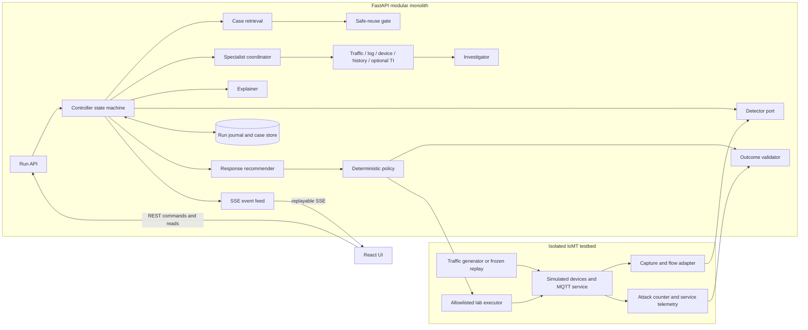

# MediSOC Agentic Pipeline Implementation Plan

**Owner:** Haider Abbas  
**Status:** Architecture software implemented; external integration and empirical acceptance pending  
**Date:** 10 October 2026  
**Repository:** `MultiAgent-IoMT-IDS-POC`  
**Research boundary:** controlled healthcare-IoMT availability and resource-exhaustion incidents

## 0. Implementation progress

**Status: the architecture software is implemented.** Final detector/data/calibration, deployment against independently instrumented lab traffic, and empirical safety acceptance remain external work. The implemented components are:

- `POST /api/runs` starts execution independently of an SSE connection; `GET /api/runs/{run_id}` returns the persisted request and status; `GET /api/runs/{run_id}/events` replays ordered events and honors `Last-Event-ID`.
- Transactional PostgreSQL and SQLite adapters share migrations for run metadata, append-only events, state snapshots, cases, action intents/receipts, rollback receipts, outcome observations, experiments, audits, and a durable case outbox. The bounded database queue uses atomic worker claims and renewable leases. Queued jobs survive restart; expired executions become interrupted with unknown pending effects and an `UNVALIDATED` terminal event. Actions are never automatically replayed.
- State events are persisted as the run's latest controller state, and specialist findings now carry a run ID, stable worker ID, source provenance, start offset, and measured worker latency. Specialist output is size-bounded and malformed output becomes an explicit unavailable result without cancelling sibling workers.
- Risk assessment and case-similarity routing are separate functions. The controller validates its state transitions; missing required evidence now forces policy escalation rather than action downgrade.
- Response actions share a canonical catalog. The policy gate and executor independently check action, duration, and target. The simulated executor reports its simulated effect explicitly; a separate authenticated gateway service provides allowlisted lab action, rollback, status/reconciliation, and telemetry interfaces. Intent precedes effect and receipts follow it. Lost acknowledgements remain unknown for review.
- Disposable specialist processes provide bounded concurrency, individual deadlines, termination on timeout/cancellation, and independent measured process resource usage. Explicit `inprocess` mode is available for deterministic development runs. Frozen history snapshots prevent workers from reloading changed case evidence.
- The shared gateway stub is serialized locally. Durable target locks exclude concurrent live runs across workers, and pending/unknown or still-active prior actions continue blocking a target after terminal completion or lock release.
- Verified fast reuse is disabled by default (`ENABLE_VERIFIED_REUSE=false`). Retrieved cases remain visible for comparison, but they cannot skip investigation until detector calibration and independent traffic-effect measurement are available.
- Independent counter consumption checks attack suppression and legitimate service effect against sustained fresh baselines. Missing, stale, reset, or inconsistent sensors produce `UNVALIDATED`; availability recovery alone cannot establish success. Three compatible independent live successes can establish reusable evidence; distinct run IDs are counted once, incompatible versions/actions are excluded, and an adverse matching outcome vetoes the precedent. Fixture and replay outcomes cannot enter learned live memory.
- API keys provide viewer/operator/admin roles, browser sessions, durable revocation, and audit records. The operational UI supports authenticated runs, cancellation, action inspection and reconciliation; the API also accepts source modes and authenticated detector/evidence inputs.
- The paired evaluation harness freezes memory and records suite, configuration, code/model hashes and seeds. Reports use journaled latency and measured specialist process CPU/peak RSS; unsupported or in-process measurements remain null. Empirical outcome acceptance requires independently instrumented live runs.
- The live UI starts a run with POST, listens to its replayable SSE resource, and can request cooperative cancellation by durable run ID. `EventSource` reconnection can recover from transient disconnects without duplicating the run.
- Cancellation before an effect ends `CANCELLED`; cancellation after a confirmed simulated effect requests rollback. An unconfirmed rollback ends in `SAFE_HOLD`, with an explicit unvalidated outcome.

Runtime instructions are in [RUNTIME_RUNBOOK.md](RUNTIME_RUNBOOK.md); implementation and verification evidence are recorded in [IMPLEMENTATION_STATUS.md](IMPLEMENTATION_STATUS.md). This software completion does not establish trained detector accuracy, actual deployed firewall efficacy, real independent sensor instrumentation, or clinical safety. The team must supply and calibrate the final detector, deploy the isolated gateway and independent sensors, and complete empirical acceptance. Persisted journals support review and replay of events; they do not authorize restarting an interrupted action.

| Phase | Current status | Remaining exit evidence |
|---|---|---|
| 0 — Contracts | Implemented | Final detector/schema contract acceptance |
| 1 — Run lifecycle | Transactional queue, leases, cancellation and replayable journal implemented | Target deployment checks |
| 2 — Routing and evidence | Disposable processes, bounded join, provenance and fallbacks implemented | Final detector and live evidence integration |
| 3 — Policy and execution | Catalog, authenticated gateway adapter, reconciliation and target exclusivity implemented | Actual isolated network deployment and effect verification |
| 4 — Outcomes and reuse | Independent counter validator and measured recurrence/veto implemented | Independent instrumentation and empirical outcome study; reuse defaults off |
| 5 — Persistence and operations | PostgreSQL/SQLite, auth roles/sessions/revocation, audits and operational UI implemented | Deployment and recovery acceptance in the intended environment |
| 6 — Evaluation | Frozen paired harness and measured process resource reporting implemented | Final-data experiments, uncertainty and safety acceptance |

## 1. Purpose

This plan turns the approved FYP proposal and supporting architecture into an implementation sequence. It covers agent responsibilities, communication contracts, synchronization, latency, error handling, case reuse, safety, persistence, UI integration, evaluation, and testing. Implementation must be possible before the detector owner provides the final data and model, so detection and lab functions will be introduced through adapters and fixtures.

The product is a research proof of concept for an isolated lab. It is not an autonomous defense product for a production hospital network.

## 2. Research objective and architecture decision

The research question is whether a context- and outcome-aware reuse gate can reduce repeated investigation without increasing incorrect or harmful response decisions in an IoMT availability-attack setting.

Keep the proposal's conceptual flow:

`Observe -> Detect -> Route -> Retrieve -> Gate reuse -> Investigate -> Recommend -> Enforce policy -> Execute in lab -> Measure -> Write back`

Implement it as a **modular monolith** first:

- One FastAPI service owns the run lifecycle.
- One Controller is the only workflow coordinator.
- Memory, investigation, specialists, explanation, response, policy, executor, and outcome measurement are modules behind typed interfaces.
- Independent specialists run in disposable spawned processes under a shared concurrency limit. Async parent tasks supervise startup, deadlines, result collection and termination.
- PostgreSQL is the shared deployed source of truth; SQLite uses the same repository contract for local development. Database transactions govern queue claims, target locks, event ordering and case writes.
- Use REST for commands and queries and replayable SSE for server-to-UI events.
- A standalone run worker service can claim jobs from the database queue; Redis Streams and a vector database remain optional future choices requiring measured need. Structured case fields and safety compatibility remain authoritative.

Do not start by adding more autonomous agents. Start by making every boundary, state transition, and evidence source explicit.

## 3. Product scope and non-goals

### In scope

- One controlled availability/resource-exhaustion family: DoS/DDoS and aligned TCP, UDP, ICMP, and MQTT flood scenarios as data and lab capabilities become available.
- Capture/model adapters that accept replayed or live feature windows.
- Confidence- and risk-aware investigation depth.
- Case retrieval and a deterministic safe-reuse decision.
- Concurrent specialist evidence gathering with provenance and per-worker timeouts.
- Bounded recommendation, deterministic safety policy, and allowlisted lab actions.
- Independent measurement of attack effect and legitimate service health.
- Append-only run events and experiment manifests sufficient for replay and paired evaluation.

### Explicitly out of scope

- Production hospital deployment, real clinical devices, unrestricted firewall/shell commands, autonomous clinical decisions, unrelated attack families, generic malware response, multi-hospital management, and claims that an LLM or multi-agent design is itself novel.

## 4. Component boundaries and authority

| Component | Responsibility | Authority boundary |
|---|---|---|
| Edge/Capture adapter | Ingest PCAP/flow/window input, normalize feature schema, resolve registered lab target | Supplies evidence only; does not route or act |
| Detector adapter | Call the selected model and produce prediction, confidence semantics, version, and feature evidence | Does not select a path or response |
| Controller | Own run state, event ordering, scheduling, deadlines, retries, cancellation, and finalization | Only module allowed to advance workflow state |
| Memory retriever | Rank candidate cases and return compared fields and candidate evidence | Cannot authorize reuse |
| Safe-reuse gate | Apply hard compatibility checks and choose verified reuse, delta investigation, or full investigation | Deterministic; cannot recommend or execute actions |
| Evidence specialists | Analyze one domain and return findings, source provenance, limitations, and timing | Cannot call other agents, mutate state/cases, or take actions |
| Investigator | Fuse current evidence and expose conflict, uncertainty, and missing evidence | Cannot silently convert missing input into a negative finding |
| Explainer | Produce a concise or detailed audit explanation from structured results | Cannot change routing, policy, or outcome |
| Response recommender | Select one candidate from a typed action catalog and explain why | Recommends only; no command execution |
| Policy gate | Check allowlists, target criticality, confidence status, duration, reversibility, and approval rules | Sole authorization decision; fails closed |
| Lab executor | Apply an allowlisted, expiring, idempotent action to a registered lab target | Independently validates lab mode and target; rejects free-form commands |
| Outcome validator | Join traffic-effect and legitimate-service telemetry and label the result | Cannot infer success from an accepted action or HTTP recovery alone |
| UI | Create/observe/cancel runs, inspect findings, audit decisions and show source mode | Presentation/control client; not a source of truth |

## 5. Topology



Controller and reasoning boxes are modules supervised by the run worker. Specialists are disposable child processes; the lab gateway is a separately deployable service. The detector remains an adapter behind a stable Controller contract.

## 6. Agent synchronization and data flow

### 6.1 Controller state machine

Persist a transition before requesting its side effect. Suggested states:

`CREATED -> CAPTURING -> DETECTED -> CONTEXT_READY -> ROUTED -> INVESTIGATING -> EVIDENCE_READY -> RECOMMENDED -> POLICY_CHECKED -> ACTION_PENDING -> ACTION_APPLIED -> VALIDATING -> FINALIZED`

Explicit terminal/exception states: `NO_INCIDENT`, `ESCALATED`, `SAFE_HOLD`, `CANCELLED`, `FAILED`, and `UNVALIDATED`.

Only the Controller advances workflow state. Transitions validate their predecessor, while a leased run owner and transactional monotonically increasing event sequence prevent simultaneous controllers from advancing the same run. Terminal runs reject further journal writes.

### 6.2 Run sequence

1. UI sends `POST /api/runs` with scenario/profile, detector adapter, and an `Idempotency-Key`.
2. API creates a stable `run_id`, freezes run configuration and source mode, persists `RUN_CREATED`, and schedules the run task. Repeated requests with the same key return the existing run.
3. Capture/replay adapter yields versioned feature windows. Detector adapter returns a `DetectorEvent` with model version and confidence semantics.
4. Controller persists `INCIDENT_DETECTED`. Candidate retrieval and mandatory device-context resolution run concurrently where inputs permit.
5. Safe-reuse gate applies hard compatibility checks before scoring similarity. It returns `VERIFY_REUSE`, `INVESTIGATE_DELTA`, or `INVESTIGATE_FULL` with a reason for every condition.
6. Controller picks the specialist set. Independent workers receive immutable evidence snapshots and run concurrently. Each result is correlated by `run_id`, `incident_id`, and `worker_request_id`.
7. Controller joins at a required-evidence barrier or deadline. Investigator fuses the current findings; missing optional data becomes an explicit evidence gap. Missing mandatory data forces safe hold or a conservative path.
8. Explainer and response recommender receive structured objects. Explanation may run after action recommendation and must not delay the action path.
9. Policy gate evaluates the exact target/action/parameters. `ESCALATE` produces no executor call. `PASS` or safe `DOWNGRADE` produces a single idempotent action intent.
10. Executor confirms applied, rejected, or unknown state. If the response is ambiguous after timeout, reconcile by idempotency key; never resend blindly.
11. Outcome validator watches while the attack generator is still active, then checks the required hold period. A health probe alone cannot prove attack suppression.
12. Persist outcome, telemetry references, and case write-back decision. Only eligible, measured outcomes may update reuse reliability.

### 6.3 Specialist fan-out/fan-in

- Always obtain detector provenance and target/device context before autonomous action.
- Traffic analysis, log analysis, device context, and history analysis can run concurrently if their inputs are ready.
- Threat intelligence is optional/advisory unless a registered policy rule explicitly requires it.
- For delta investigation, invoke workers based on the changed/unknown evidence fields, not a fixed group for every partial match.
- Workers do not communicate directly. The Controller dispatches and correlates; the Investigator merges.
- Async supervisors collect disposable process results under individual deadlines and a shared concurrency bound. Timeout/cancellation terminates the corresponding child. One malformed or failed result becomes unavailable without cancelling sibling findings.
- Emit `worker.started`, `worker.completed`, `worker.unavailable`, and `worker.failed` lifecycle events with measured duration.

## 7. Communication contracts

Use Pydantic as the backend contract source and generate or validate TypeScript types from OpenAPI. Version the public event contract. Avoid keeping two manually maintained schemas.

### 7.1 Persisted event envelope

```json
{
  "schema_version": 1,
  "event_id": "run_abc:17",
  "run_id": "run_abc",
  "incident_id": "inc_xyz",
  "sequence": 17,
  "correlation_id": "worker_req_123",
  "occurred_at": "2026-10-10T10:00:00Z",
  "type": "specialist.completed",
  "source": "traffic_analysis",
  "payload": {}
}
```

Every event has a unique ID, monotonic per-run sequence, UTC timestamp, schema version, source, and typed payload. Store before publishing. Client reduction is idempotent on `event_id`/sequence.

### 7.2 Required domain contracts

- `RunRequest`: frozen scenario/profile ID, source mode, requested detector/model version when known, fault-injection options restricted to demo mode, and caller idempotency key.
- `DetectorEvent`: family/subtype, prediction, confidence value and `confidence_kind` (`calibrated`, `raw`, `aggregate`, `unknown`), model version, feature-schema version, window boundaries, target reference, evidence references, and explicit unknown fields. Do not label a mean of per-flow probabilities as a calibrated incident posterior.
- `SpecialistFinding`: worker/version, status (`OK`, `PARTIAL`, `UNAVAILABLE`, `ERROR`), finding payload, provenance, source references, observed interval, confidence/limitations, and latency.
- `ReuseDecision`: path, candidate IDs, score by field, fields not compared, subtype/device compatibility, prior outcome and reliability sample count, decision, and rejection reasons.
- `InvestigationResult`: confirmed/uncertain facts, conflicts, evidence gaps, current-vs-prior differences, worker list, and response constraints.
- `ActionRecommendation`: enum action, structured parameters, target ID, expiry/duration, reversibility, evidence refs, and rationale. Never shell text.
- `PolicyDecision`: verdict, policy version, individual checks, permitted post-downgrade action, and approval requirement.
- `OutcomeReport`: attack suppression, legitimate service availability/delivery/latency, resource telemetry, validation interval, sensor quality, collateral impact, rollback, label, and evidence refs. Missing metrics are represented as unmeasured, not zero.

### 7.3 HTTP and event API

```text
POST /api/runs                           create or return idempotent run
GET  /api/runs/{run_id}                  current state and frozen config
GET  /api/runs/{run_id}/events           replayable SSE; Last-Event-ID supported
POST /api/runs/{run_id}/cancel           cancel before action or initiate rollback after action
GET  /api/incidents/{incident_id}        reconstructed incident record
GET  /api/cases                          cases and provenance
GET  /api/evaluation/experiments         frozen measured summaries
GET  /api/health                         dependencies, model, DB, and lab-mode state
```

Opening an event stream never creates a run. SSE reconnect uses `Last-Event-ID`; the server returns later persisted events then waits for new events. If the UI disconnects, execution continues server-side. The retired `/api/simulate/stream` route returns HTTP 410; clients create runs through POST and observe their run resource.

## 8. Routing, reuse, and safety policy

### 8.1 Investigation paths

| Path | Conditions | Work |
|---|---|---|
| `VERIFY_REUSE` | Trusted/calibrated detector signal; supported subtype; compatible device and action context; prior outcome fully measured and non-harmful; reliability supported by enough observations; no conflict | Verify required current facts and adapt only the reusable prior reasoning |
| `INVESTIGATE_DELTA` | Relevant case exists but one or more decision-relevant fields differ or are unknown | Investigate only those fields, plus mandatory safety context |
| `INVESTIGATE_FULL` | No safe candidate, novel subtype, low/untrusted detector, critical or unknown device, conflicting evidence, or incomplete mandatory evidence | Run all decision-relevant workers and synthesize the full evidence set |

Initial implementation defaults to `INVESTIGATE_FULL` or `INVESTIGATE_DELTA`; **verified reuse remains feature-flagged off** until calibration and real lab outcomes exist. A high similarity score alone never authorizes skipping work. Critical or unknown device context never takes a fast path.

### 8.2 Deterministic policy

The Policy Gate must check at least:

1. Target belongs to the registered isolated lab and lab mode is enabled.
2. Target/source is not on a protected allowlist.
3. Detector confidence is trusted for the model version and meets the configured action threshold.
4. Required device context is known; unknown is treated as most restrictive.
5. Action enum and parameter bounds are permitted for target class.
6. Action has a bounded duration/expiry and is reversible where required.
7. Human approval is present for any configured high-risk action.

Unknown policy input or policy service failure means `ESCALATE` and no execution. The executor independently repeats lab-mode, target, action, duration, and idempotency checks.

### 8.3 Outcome-gated learning

- Persist all runs for audit, including incomplete runs.
- Store/update reusable cases only when required telemetry is measured and passes the frozen data-quality checks.
- `UNVALIDATED` is distinct from `FAILURE`: missing sensors prove neither success nor failure, and cannot increase trust.
- To label `SUCCESS`, require measured attack suppression **and** legitimate-service health/delivery within the pre-registered thresholds for a defined hold period while attack traffic is still active.
- If attack suppression is absent, recovery of the service health endpoint alone cannot create a successful precedent.
- `HARMFUL` takes precedence if legitimate clinical-simulation traffic is materially disrupted, even if attack traffic falls.
- Record each outcome observation separately. Reliability requires multiple observations and must be slow to increase and quick to decrease.
- Case memory never retrains or silently modifies detector weights.

## 9. Latency and throughput plan

Do not claim performance improvements from a diagram or from synthetic case-store cloning. Instrument each run using synchronized monotonic timestamps and UTC event timestamps.

Record at least:

- `T0` run request accepted;
- `T1` first capture/window;
- `T2` detection;
- `T3` memory retrieval and reuse-gate decision;
- `T4` all required specialist results or their deadlines;
- `T5` recommendation;
- `T6` policy verdict;
- `T7` action confirmed applied;
- `T8` suppression criteria first met;
- `T9` hold period satisfied and service recovered;
- `T10` final case/outcome transaction committed.

Report median/p95 for capture-to-detect, memory/reuse, specialist fan-out, recommendation, policy, action, time-to-containment, service recovery, total run time, SSE delivery lag, and event queue lag. Also measure CPU, RAM, worker concurrency, LLM/API latency and token/cost counts.

Latency ownership and controls:

- Detector latency is measured inside the detector adapter and separated from capture-window duration.
- Memory retrieval and gate evaluation are separately timed.
- Specialist workers each have independent timeouts; overall join deadline is the maximum allowed critical-path budget, not the sum of worker budgets.
- Optional explanation/Threat Intel work runs off the action critical path.
- LLM provider timeout/retry budgets are capped by the run deadline; one failed provider must not stall safety evaluation.
- SSE publish timestamps and client receive timestamps make delivery lag visible; UI animation delay is not research latency.
- Freeze measurable latency targets after the first baseline runs and paired experiments. Until then, report distributions and do not use hard-coded “speedup” values.

The existing 1.4-second per-specialist timeout may remain a demo default while being measured; tune it only against lab measurements and required evidence behavior.

## 10. Persistence and consistency

### Initial persistent model

- `run`: immutable source mode, profile, model/schema versions, state, and timestamps.
- `incident`: current summary and state version.
- `incident_event`: append-only, unique `(run_id, sequence)`, indexed by event ID and incident ID.
- `specialist_finding`: structured evidence, provenance, status, version, latency.
- `case`: canonical incident signature, constraints, and summary.
- `case_outcome`: per-run measurements and outcome evidence; supports reliability calculation.
- `action_intent`: action, policy version/verdict, parameters, idempotency key, applied/rejected/unknown status, expiry, rollback.
- `experiment_profile`: versioned attack source, timing, target, sensor configuration, and thresholds.

For a state transition, write the event and state version transactionally. For an external action, write `ACTION_PENDING` and the idempotency key before calling the executor; record the executor response afterward. On restart, reconcile an outstanding intent. Do not repeat an ambiguous action.

Use PostgreSQL before collecting final experimental data. The store adapter allows SQLite for local prototyping. JSON case files remain available as seed/fixture import files, not as concurrent shared production-of-PoC storage. Add pgvector only if an evaluated retrieval baseline shows benefit.

## 11. Fallback and failure behavior

| Failure | Required behavior |
|---|---|
| Capture/model missing, stale, or wrong schema | Mark input unavailable; no fast path; route conservatively or safe hold |
| Confidence uncalibrated/unknown | Treat as untrusted; no autonomous fast reuse/action |
| Memory unavailable | Treat as no reusable candidate; full investigation when evidence exists |
| Specialist timeout | Persist `UNAVAILABLE`; continue only if optional; mandatory gap blocks action or forces conservative policy |
| Specialist malformed result | Schema validation failure becomes `ERROR`; do not pass malformed evidence to Investigator |
| LLM unavailable, timed out, or invalid JSON | Deterministic structured fallback; same schema; no safety authority lost |
| Policy fails/cannot evaluate | `ESCALATE`; never default to pass |
| Executor fails before action | No action; record failure and escalate if required |
| Executor times out after request | Reconcile by idempotency key; do not repeat until status known |
| Monitor lacks traffic counters or service telemetry | `UNVALIDATED`; no positive case/reliability update |
| SSE client disconnect | Server continues; later reconnect replays from cursor |
| Controller process restarts | Replay persisted state; reconcile action intent; unresolved action goes `SAFE_HOLD` |
| Database unavailable | Do not begin a side-effecting action; fail closed and expose service degradation |

Retries: read-only retrieval may retry within its deadline. Worker retry is at most once and only where the data read is idempotent. No blind retry for action execution or case write-back.

## 12. Security and privacy controls

- Bind demo services to localhost unless deployment is explicitly configured.
- Require lab/safe mode and registered targets on the server; UI-only safeguards do not count.
- Keep provider credentials in ignored environment files or a secrets store; never emit credentials in health/events/logs.
- Validate and cap all request fields, worker output sizes, and run duration/rate profiles.
- Separate read-only audit endpoints from mutating run/reset/action endpoints.
- Never use real patient identifiers or payloads. Minimize captured data and store references rather than packet payload when possible.
- Auth roles and browser sessions are implemented; deploy with configured secrets, durable revocation and the network restrictions in the runbook.
- Keep prompt inputs to evidence allowlists; treat logs, packet-derived fields, and retrieved case text as untrusted data.
- Record who/what requested a run, selected profile, action decision, and any cancel/rollback.

## 13. Testing and evaluation strategy

This section defines verification and external acceptance requirements. Completed software checks are listed in [IMPLEMENTATION_STATUS.md](IMPLEMENTATION_STATUS.md); illustrative demo values are not empirical results.

### Contract and unit tests

- Pydantic validation and TypeScript/OpenAPI compatibility for every request, event, finding, decision, and outcome.
- Allowed and forbidden state transitions; monotonic sequence and idempotent event reduction.
- Reuse hard-gate matrix: subtype mismatch, unknown/critical device, harmful prior outcome, insufficient reliability/sample count, unavailable confidence calibration, incomplete telemetry.
- Policy matrix: protected target, invalid action, excessive duration, non-reversible action on protected class, missing context, missing lab mode, approval present/absent.
- Outcome matrix: both metrics measured and pass, suppression absent, service absent, suppression low, harmful service impact, degraded evidence, insufficient hold period.

### Orchestration and integration tests

- Worker fan-out reaches a barrier; one timeout does not cancel other useful findings.
- Worker responses correlate to the correct run and stale run results are ignored.
- Same idempotency key creates one run; different keys create independent runs.
- SSE reconnect with `Last-Event-ID` replays missing events once and does not create/re-execute the run.
- Crash/restart around each transition; action-intent reconciliation prevents duplicate effects.
- Database loss, memory loss, LLM timeout, malformed LLM output, worker timeout, policy conflict, executor timeout, monitor loss, and UI disconnect all produce the specified fallback.

### Controlled-lab evaluation

- Use frozen paired incident profiles under three configurations: full investigation, similarity-only reuse, and proposed context/outcome-gated reuse.
- Run each profile repeatedly with attack traffic active through the response/hold window.
- Record ground truth, capture/model versions, configuration hashes, policy version, case-store snapshot, random seed, source mode, and all telemetry timestamps.
- Compare detector metrics, Safe-Reuse Precision, Wrong-Reuse Rate, investigation step reduction, specialist count, end-to-end latency, attack suppression, service availability/delivery, harmful response rate, and API-off completion.
- Report sample counts and uncertainty; do not claim reduced LLM use unless invocation/token logs support it.
- Separate replay/fixture/stub results from live-lab experiments in stored manifests and UI labels.

## 14. Implementation phases and deliverables

### Phase 0 — contracts and architecture foundation

- Add this implementation plan and use it as the working checklist.
- Define `RunRequest`, `DetectorEvent`, `SpecialistFinding`, `ReuseDecision`, `ActionRecommendation`, `PolicyDecision`, `OutcomeReport`, and versioned `RunEvent` contracts.
- Define typed ports for Detector, Memory, Specialist, Policy, Executor, and Outcome Monitor.
- Define source modes (`fixture`, `capture_replay`, `live_lab`, `stub`) so evidence cannot be mislabeled.

**Exit:** schemas are stable enough to build Controller and fixture adapters without trained-model data.

### Phase 1 — run identity, Controller, event journal, SSE replay

- Add idempotent run creation, stable `run_id`, monotonic event sequence, persisted append-only events, and GET current run state.
- Move the UI from side-effecting SSE GET to REST create + SSE observe.
- Support `Last-Event-ID`, event deduplication, and server-side run continuation on UI disconnect.
- Keep legacy `/api/simulate/stream` temporarily for compatibility.

**Exit:** disconnect/reconnect cannot create a second run or lose persisted events.

### Phase 2 — deterministic routing and evidence coordination

- Make risk routing and reuse gate separate deterministic functions with explainable rejection reasons.
- Keep fast reuse disabled until calibration/outcomes are ready.
- Run typed specialist workers concurrently with per-worker timeout and required-evidence barrier.
- Record provenance, gaps, latency, and version for each result.

**Exit:** identical fixtures/configuration replay the same path and decisions; missing required evidence never authorizes an action.

### Phase 3 — recommendation, policy, executor boundary

- Restrict actions to an enum/catalog with typed parameters.
- Add independent server-side lab-mode, target, rate, duration, expiry, and idempotency checks.
- Add dry-run executor and action-intent reconciliation before any actual lab action.
- Keep policy failure and unknown state in safe hold/escalation.

**Exit:** no API/LLM text can bypass policy or produce an arbitrary network command.

### Phase 4 — valid outcomes and case reliability

- Add attack traffic counters and service-health/delivery sensors.
- Define pre-registered thresholds/hold period with the team and persist their version.
- Label missing/inconsistent telemetry `UNVALIDATED`; only validated outcomes can update reuse reliability.
- Track outcome observations and evidence count per reusable case.

**Exit:** stub-only recovery can never produce a successful reusable case.

### Phase 5 — persistence, UI, and operations

- Add PostgreSQL migrations and SQLite development adapter.
- Wire dashboard, incident details, case memory, and evaluation views to real APIs; mark all source modes.
- Add auth and audit controls before exposing the service beyond localhost.
- Add health/readiness checks for DB, detector, lab mode, sensors, and event publisher.

**Exit:** a reviewer can reconstruct a run and distinguish fixture, replay, stub, and live-lab evidence.

### Phase 6 — empirical comparison and release readiness

- Freeze model, data, schema, thresholds, case-store snapshots, policies, experiment profiles, and code revisions.
- Run paired baselines and ablations, analyze latency and safety outcomes, and report failures as well as successes.
- Enable `VERIFY_REUSE` only if the pre-registered safety criteria are met.

**Exit:** claims in the UI, report, and thesis are traceable to stored runs and measured evidence.

## 15. Latency acceptance and reporting

Do not hard-code speedup results. First collect baseline distributions, then agree and freeze SLO thresholds for the research environment. Report median and p95 for:

- request acceptance and first-event delivery;
- capture-to-detection and detector inference;
- memory retrieval and reuse gate;
- each specialist and fan-out critical path;
- recommendation, policy, action acknowledgement;
- time-to-containment and service recovery;
- SSE delivery lag and queue lag;
- full-run duration, throughput, CPU/RAM, LLM latency/cost.

Use monotonic clocks for elapsed time, UTC for stored event times, and one process-independent run timing convention. UI animation delay is never included in system/containment latency.

## 16. Definition of done for the full pipeline

- All components communicate only through versioned typed contracts or explicit adapters.
- Controller is the sole workflow owner; specialist concurrency has a defined join/deadline rule.
- Every run is identifiable, idempotent, persisted, replayable, and auditable.
- All missing/unknown evidence is explicit and triggers the planned fallback.
- Reuse requires measured, context-compatible precedent and never relies on similarity alone.
- Policy and executor are separate; executor independently enforces the lab boundary.
- `SUCCESS` requires attack-effect and legitimate-service evidence over the hold period.
- UI and reporting distinguish fixture, replay, stub, and live-lab sources.
- The test matrix and paired experiments are complete before any scientific performance/safety claim is made.

## 17. Open decisions to resolve before lab evaluation

1. Which attack counter proves continued attack and suppression at the gateway?
2. Which service-health, delivery, latency, CPU/RAM, and collateral sensors are available?
3. What are the action allowlist and human approval rules for each simulated device class?
4. What calibration method, confidence kind, and model-specific thresholds will the detector owner provide?
5. What repeated-trial count and reliability uncertainty are sufficient before a case can be trusted?
6. Which database is available for the team environment and where will experiment artifacts live?
7. Which teammate owns capture/device attribution and which owns the lab executor interface?

## 18. Immediate implementation priority

The initial run journal and outcome guard increment is complete, followed by the queue, worker isolation, shared persistence, gateway interfaces, measured reuse, operational UI and evaluation harness. The next project milestone is external integration: receive the final detector/schema/calibration, deploy the isolated gateway with independent instrumentation, and run the frozen empirical acceptance study. Typed interfaces preserve the architecture during that integration.

## 19. Source of truth

This plan operationalizes the final proposal, revised technical pipeline, metrics framework, dataset strategy, web-application design proposal, and the current PoC architecture notes. If implementation constraints require a deviation, update this plan and record why before making UI or thesis claims based on the changed behavior.
